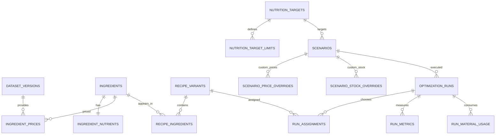

# GiziOptima — Blueprint Teknis v0.1

<!-- source: 00_HOME.md -->
---
type: moc
project: gizioptima
status: active
created: 2026-11-19
version: 0.1
---
# GiziOptima Adaptive Procurement — Project Brain
> **Status:** Blueprint v0.1 (BELUM ada aplikasi, dataset produksi, atau validasi ahli gizi). Sumber riset dan ketentuan lomba tercantum pada [[Sources and Evidence]].

## North Star
**Sistem pendukung keputusan untuk membuat menu berbasis resep terverifikasi, menilai kepatuhan gizi, mengoptimalkan biaya dan stok, lalu mengoptimasi ulang saat harga atau pasokan berubah.** Bukan pengganti ahli gizi, sistem BGN, atau sistem pengadaan resmi.

## Navigasi
- Produk: [[Product Requirements Document]], [[User Flows]], [[Acceptance Criteria]], [[Competitive Positioning]]
- Domain: [[Sources and Evidence]], [[Regulatory and Nutrition Guardrails]], [[Data Policy and Provenance]]
- Teknik: [[Architecture]], [[Data Dictionary]], [[MILP Mathematical Model]], [[Database Schema]], [[API Contract]], [[Backend Modules]], [[Fixtures and Examples]]
- Pengujian: [[Experiment Plan]], [[Risk Register]]
- Delivery: [[Roadmap and Backlog]], [[Definition of Done]]
- Keputusan: [[ADR-001 Recipe-Based MILP]], [[ADR-002 CSV First and Provenance]], [[ADR-003 AI Explanation After Validation]]
- Prompts: [[Master Implementation Prompt]], [[Prompt Sprint 0]], [[Prompt Sprint 1]], [[Prompt Sprint 2]], [[Prompt Sprint 3]], [[Obsidian Brain Operating Prompt]]
- Riwayat: [[2026-11-19 Project Kickoff]]

## Keputusan yang sudah diambil
1. Fokus 1 SPPG simulasi, 1 kelompok sasaran, 5 hari, satu waktu makan per hari, jumlah porsi N tetap.
2. 20–30 bahan, 12–24 varian resep, 4 slot menu (pokok/protein/sayur/buah), 2 skenario harga.
3. Nutrisi dan batasan harus ditautkan ke sumber serta disetujui ahli gizi. **Angka contoh sintetis BUKAN standar resmi.**
4. Harga beli melalui CSV/manual; harga Bapanas adalah referensi pembanding, bukan asumsi kontrak SPPG.
5. Output bertipe `OPTIMAL`, `FEASIBLE` atau `INFEASIBLE`, dengan trace `run_id` dan snapshot input.
6. LLM tidak mengubah hasil solver; AI tambahan untuk interpretasi hasil dan, nanti, normalisasi nama bahan.

## Pertanyaan terbuka prioritas tinggi
- [ ] Dapatkah seorang ahli gizi memeriksa profil target dan varian resep? [BLOCKER validasi gizi]
- [ ] Sumber data TKPI apa yang dapat dipakai dalam format berlisensi/diizinkan? [BLOCKER data]
- [ ] Apakah cakupan menu hanya makan siang kelompok sasaran tertentu? [produk]
- [ ] Jadwal lomba resmi masih konflik antara bagian guidebook. Konfirmasi panitia. [kompetisi]

## Prinsip kerja dengan coding agent
Baca [[Master Implementation Prompt]]. Setiap perubahan besar: tulis ADR, perbarui dokumentasi, catat hasil pengujian, dan bawa hasilnya ke catatan harian. Jangan pernah mengklaim validasi gizi atau hasil penghematan yang belum terukur.


---

<!-- source: 01_Strategy/Competitive Positioning.md -->
---
type: strategy
status: hypothesis
project: gizioptima
---
# Competitive Positioning
## Masalah yang dipilih
Penyusunan menu saja bukan celah yang cukup berbeda: dokumentasi resmi SIPGN mencakup AI Menu Planner, SCM, dan ERP. Hipotesis diferensiasi kita: **re-optimasi varian resep terverifikasi ketika harga dan stok bergeser, lengkap dengan analisis trade-off, feasibility diagnosis, dan audit trail.** Belum ada bukti bahwa fungsi ini tidak tersedia pada platform lain; jangan klaim sebagai yang pertama.

## Positioning
Untuk operator perencana menu dan penanggung jawab dapur yang menghadapi harga atau stok tidak stabil, GiziOptima adalah *decision-support sandbox* yang menunjukkan apakah rencana 5 hari masih feasible dan alternatif yang paling ekonomis sesuai aturan yang telah disetujui ahli gizi.

## Bukan target MVP
Tidak menggantikan SIPGN, tidak mengklaim status akreditasi A/B/C, tidak menjamin keamanan pangan dari foto, tidak melakukan pembelian otomatis, tidak menjamin standar resmi tanpa verifikasi domain.

## Hipotesis nilai
- H1: Lebih cepat menghasilkan rencana feasible daripada spreadsheet manual.
- H2: Untuk skenario yang feasible, biaya optimasi <= baseline resep tetap.
- H3: Pada kenaikan harga, solusi dapat menyesuaikan komposisi tanpa melanggar hard constraints.
- H4: Pengguna memahami alasan substitusi dan tahu ketika tidak ada solusi.

## Benchmark kompetitor
1. SIPGN AI Menu Planner / ERP / SCM: https://portal-doc-sipgn.bgn.go.id/panduan-sipgn/persiapan-produksi/menu-planner
2. SIPGN SCM: https://portal-doc-sipgn.bgn.go.id/panduan-sipgn/pengadaan/scm
3. SIPGN ERP: https://portal-doc-sipgn.bgn.go.id/panduan-sipgn/pengadaan/erp

## Pitch satu kalimat
'Ketika telur naik harga atau pemasok terlambat, GiziOptima memeriksa kelayakan rencana dan menghitung alternatif menu yang dapat dijelaskan — bukan sekadar membuat daftar menu baru.'


---

<!-- source: 02_Product/Product Requirements Document.md -->
---
type: prd
status: draft
version: 0.1
project: gizioptima
owner: product
last_reviewed: 2026-11-19
---
# Product Requirements Document
## 1. Identitas
- Nama: **GiziOptima Adaptive Procurement**
- Track: AI Builder Challenge 2026, General Track
- Tahap: **MVP demo terukur**, belum untuk pengambilan keputusan produksi tanpa ahli gizi.
- Pengguna utama: perencana menu/kepala dapur simulasi; reviewer: ahli gizi; audiens demo: juri.

## 2. Problem statement
Perubahan harga dan pasokan mengganggu menu yang telah direncanakan. Sistem perlu mengevaluasi apakah susunan menu 5 hari tetap memenuhi anggaran, nutrisi, variasi dan stok, lalu menawarkan alternatif **dari varian resep yang sudah diverifikasi**, beserta alasan dan jejak keputusan.

## 3. Outcomes / North Star
Sistem menghasilkan `OptimizationRun` lengkap: asumsi + versi data + status kelayakan + rencana hari-ke-hari + ringkasan biaya/nutrisi/stok + perubahan terhadap baseline. Tidak ada kasus menampilkan menu tak feasible sebagai rekomendasi valid.

## 4. Scope MVP (P0)
- Satu dapur simulasi, satu kelompok sasaran, satu sesi makan (mis. makan siang), lima hari kerja.
- Upload/import CSV master bahan, nutrisi per 100g, harga per satuan, stok gram bahan mentah, varian resep, profil target gizi.
- Data cleaning, validasi unit, nama bahan canonical, provenance sumber dan tanggal.
- CRUD sederhana master bahan/resep; resep hanya diaktifkan setelah status `reviewed`.
- Membuat baseline 5 hari; mengubah harga atau stok dalam skenario terpisah.
- Optimasi MILP dengan hard constraints: slot, kebutuhan gizi, anggaran, stok, alergi/pantangan, repeat cap.
- Optimizer result: `OPTIMAL` / `FEASIBLE` / `INFEASIBLE` / `ERROR` / `TIME_LIMIT`, serta alasan kegagalan yang aman.
- Compare baseline vs adjusted scenario, hasil dalam tabel, biaya/serving, nutrisi/serving, daftar belanja, export CSV.
- Audit trail snapshot input & parameter solver; tidak mengubah baseline saat skenario baru dibuat.

## 5. Scope P1 (sesudah MVP)
- Analisis sensitivitas kenaikan harga (0, +10%, +20%, +30%) untuk setiap bahan utama.
- AI explanation dengan input JSON hasil solver saja dan validasi numerik setelah generation.
- Penamaan bahan baku ke TKPI via semantic matching dengan review manual (jangan auto-approve).
- Beberapa kelompok sasaran; multi-quantity, vendor price quotes, probabilistic stock lead time.

## 6. Out of scope
Integrasi langsung SIPGN/ERP BGN, OCR foto nampan untuk jaminan keamanan pangan, prediksi keracunan, sertifikasi gizi atau halal, order/pembayaran vendor, model nutrisi rekomendasi medis personal, klaim resmi akreditasi SPPG.

## 7. User stories
- US-01 sebagai operator, saya dapat mengimpor data bahan dan mengetahui baris yang salah.
- US-02 sebagai reviewer, saya dapat menandai resep dan profil target gizi yang sudah diverifikasi.
- US-03 sebagai operator, saya dapat menghasilkan satu menu 5 hari yang feasible atau pesan gagal yang jelas.
- US-04 sebagai operator, saya dapat mengubah harga telur di skenario dan membandingkan menu/cost.
- US-05 sebagai operator, saya dapat melihat bahan mana yang membatasi solusi serta menyimpan hasil untuk audit.
- US-06 sebagai juri, saya dapat menjalankan demo end-to-end pada data baru yang sintetik.

## 8. Business rules penting
1. Seluruh rupiah disimpan sebagai angka desimal atau integer rupiah; komputasi optimasi memakai koefisien numerik yang konsisten.
2. Unit harga `IDR/kg` dikonversi ke `IDR/g` hanya untuk bahan basis gram; `liter` butuh densitas/konversi yang direview.
3. Cost memakai berat belanja mentah; nutrisi memakai berat bagian dapat dimakan dan faktor retensi gizi.
4. Resep kandidat harus feasible secara resep dan ditinjau ahli gizi sebelum dianggap valid produksi.
5. Menu `INFEASIBLE` harus ditunjukkan jelas dan tidak diekspor sebagai 'menu siap pakai'.
6. Skenario bisa dijalankan tanpa LLM. LLM hanya menjelaskan, tidak menghitung constraint.

## 9. Success criteria MVP (target; belum hasil)
- 100% hard constraints benar pada seluruh solusi yang diterima validator independen.
- 0 klaim feasible bila solver/validator menyatakan infeasible.
- Minimal 5 skenario otomatis (baseline, price shock, shortage, infeasible, allergy/repeat).
- End-to-end upload -> optimize -> compare -> export berjalan di lingkungan demo.
- p95 optimizer < 10 detik pada fixture 5 hari/24 varian (target lingkungan pengujian, bukan jaminan).

## 10. Dependencies & uncertainties
- Validasi ahli gizi terhadap target nutrisi dan varian resep (**blocked** sebelum klaim kepatuhan nyata).
- Peraturan BGN No. 5 Tahun 2026 dan juknis aktif harus diverifikasi interpretasi lengkapnya.
- TKPI satuan/edible fraction dan harga pemasok aktual mungkin tidak tersedia; gunakan sample sintetis berlabel untuk demo.
- Guidebook berisi versi jadwal bertentangan: validasi ke panitia.

## 11. UI utama
`/data` impor data; `/recipes` review; `/scenarios` membuat scenario; `/optimize` hasil; `/compare` before/after; `/runs/:id` detail audit.


---

<!-- source: 04_Engineering/Data Dictionary.md -->
---
type: data-dictionary
status: v0.1
---
# Data Dictionary
**Konvensi:** UUID PK, UTC timestamps; monetary sebagai `NUMERIC(14,4)` ketika per-gram dan `NUMERIC(14,2)` ketika IDR; satuan berat mentah gram (`g`); nilai gizi TKPI per `100g edible portion`; IDR/kg dikonversi tepat dibagi 1000 menjadi IDR/g. `NULL` tidak diganti 0 tanpa bukti.

| Entitas | Field kunci | Tipe / unit | Validasi / arti |
|---|---|---|---|
| `dataset_versions` | `id`, `name`, `source_type`, `source_url`, `created_at`, `is_synthetic`, `review_status` | UUID, strings, timestamp, bool | Jejak dataset, immutable |
| `ingredients` | `id`, `code`, `name`, `category`, `edible_fraction`, `allergens`, `nutrient_source_id` | UUID, str, 0..1, list | Nama canonical, BDD fraction |
| `ingredient_nutrients` | `ingredient_id`, `energy_kcal_100g`, `protein_g_100g`, `fat_g_100g`, `carb_g_100g`, `fiber_g_100g`, `iron_mg_100g` | numeric per 100g edible | Missing => unknown; tidak isi dari LLM |
| `ingredient_prices` | `id`, `ingredient_id`, `price_idr_per_g`, `original_value`, `original_unit`, `region`, `observed_at`, `source_type`, `dataset_version_id` | IDR/g + source | Snapshot harga, positive |
| `inventory_snapshots` | `id`, `scenario_id`, `ingredient_id`, `stock_raw_g`, `recorded_at` | g (raw) | Stok bahan mentah, >=0 |
| `recipe_variants` | `id`, `name`, `slot`, `review_status`, `reviewer`, `reviewed_at`, `allergen_tags`, `active` | enum slot, strings | Hanya reviewed untuk compliant run |
| `recipe_ingredients` | `recipe_id`, `ingredient_id`, `raw_g_per_serving`, `retention_factor` | g, factor 0..1 | Beli raw; nutrisi edible*retention |
| `nutrition_targets` | `id`, `cohort`, `meal_type`, `source_ref`, `version`, `review_status` | str, enum | 1 cohort/meal untuk MVP |
| `nutrition_target_limits` | `target_id`, `nutrient_key`, `min_per_serving`, `max_per_serving`, `unit` | `kcal`, `g`, `mg` | max nullable jika hanya minimum |
| `scenarios` | `id`, `name`, `parent_scenario_id`, `dataset_version_id`, `target_id`, `servings_per_day`, `budget_idr_per_serving`, `days`, `created_at` | UUID, int, IDR | Immutable scenario snapshot after optimize |
| `scenario_price_overrides` | `scenario_id`, `ingredient_id`, `price_idr_per_g` | IDR/g | Override price WITHOUT modifying master |
| `scenario_stock_overrides` | `scenario_id`, `ingredient_id`, `stock_raw_g` | g | Override stock scenario only |
| `optimization_runs` | `id`, `scenario_id`, `solver_status`, `objective_total_idr`, `solver_seconds`, `model_version`, `input_sha256`, `created_at`, `validation_passed` | UUID, enum, numeric, bool | Snapshot/audit; `objective` nullable infeasible |
| `run_assignments` | `run_id`, `day_index`, `slot`, `recipe_id` | FK, int, enum | satu resep/slot/hari jika feasible |
| `run_metrics` | `run_id`, `day_index`, `nutrient_key`, `value`, `min`, `max`, `unit` | numeric | Debug kepatuhan per hari |
| `run_material_usage` | `run_id`, `ingredient_id`, `used_raw_g`, `available_raw_g` | g | Stok & daftar belanja |

## Enum draft
- `slot`: staple, protein, vegetable, fruit.
- `review_status`: draft, needs_review, reviewed, rejected.
- `solver_status`: OPTIMAL, FEASIBLE, INFEASIBLE, TIME_LIMIT, ERROR.
- `source_type`: official, uploaded, research, synthetic.

## Transformations
- Cost raw (per recipe r): `c_r = SUM_i raw_g_per_serving[r,i] * price_idr_per_g[i]`.
- Nutrient (per recipe r, nutrient k): `a_rk = SUM_i (raw_g_per_serving[r,i] * edible_fraction[i]/100) * nutrient_100g[i,k] * retention_factor[r,i,k]`.
- Saat retention berbeda per-nutrient, desain tahap berikutnya menambah tabel retention per nutrient; MVP satu factor terverifikasi atau flag estimate.
- Total pembelian (raw g) = `SUM_{d,r} servings[d] * raw_g_per_serving[r,i] * x[d,r]`.

## Aturan kualitas data
- `ingredient.code` unique; review manual alias; `edible_fraction` >0 <=1.
- `raw_g_per_serving` >0; price >0; stock >=0; days 1..14; servings 1..10000.
- Nutrisi wajib energy & protein untuk fixture; tidak boleh klaim valid terhadap nutrient yang tidak punya datanya.
- `review_status=reviewed` harus menyimpan siapa dan kapan melakukan peninjauan.


---

<!-- source: 04_Engineering/MILP Mathematical Model.md -->
---
type: math-model
status: proposed
---
# MILP Mathematical Model
## Model MVP berbasis resep yang sudah direview
**Mengapa recipe-based?** Memilih bahan individual bisa menghasilkan kombinasi tak masuk akal. Setiap `r` adalah **varian resep per porsi** dengan komposisi gram tetap dan telah diverifikasi.

### Himpunan
- `D={1,...,5}`: hari; `T={staple,protein,vegetable,fruit}`: slot.
- `R_t`: varian resep dalam slot `t` (semua `reviewed`).
- `I`: bahan baku; `K`: zat gizi yang disyaratkan oleh target profil.

### Parameter
- `N_d`: jumlah porsi hari d; `B_d`: batas biaya rupiah/porsi/hari (konfigurasi, bukan angka resmi fixed).
- `g_{ir}`: gram **bahan mentah** i pada satu porsi varian r.
- `u_i`: harga IDR per gram bahan mentah i untuk satu scenario.
- `c_r = Σ_i u_i*g_{ir}`: biaya resep per serving.
- `a_{rk}`: kuantitas zat gizi k per serving varian r, dihitung dari edible yield & nutrisi per 100g.
- `L_{dk}`, `U_{dk}`: batas min/max zat gizi k untuk seluruh paket menu hari d. `U` opsional.
- `S_i`: stok raw gram bahan i untuk keseluruhan rencana.
- `M_f`: batas pengulangan keluarga resep/protein family f selama 5 hari.
- `allowed_{dr}`: 0 atau 1 untuk alergen/pantangan atau penjadwalan.

### Variabel keputusan
`x_{dr} ∈ {0,1}`: pilih resep r pada hari d. Karena tiap slot satu resep, menu terdiri dari tepat empat komponen (atau konfigurasi slot lain yang divalidasi).

### Objektif (v0.1)
Minimalkan total procurement cost:

`min Σ_d N_d * Σ_r c_r * x_{dr}`

Preferensi variasi cukup dipasang sebagai hard repeat cap dulu supaya objektif tetap jelas. Opsional v0.2: penalti jarak dari menu awal, dengan bobot transparan dan uji sensitivitas.

### Hard constraints
1. **Slot coverage**: `Σ_{r ∈ R_t} x_{dr} = 1`, untuk setiap d,t.
2. **Available/allowed**: `x_{dr} <= allowed_{dr}` (0 jika alergi/resep tidak direview).
3. **Per-day budget**: `Σ_r c_r*x_{dr} <= B_d` untuk tiap d.
4. **Nutrition floor**: `Σ_r a_{rk}*x_{dr} >= L_{dk}` untuk setiap d,k.
5. **Nutrition ceiling (jika berlaku)**: `Σ_r a_{rk}*x_{dr} <= U_{dk}`.
6. **Raw ingredient stock**: `Σ_d N_d Σ_r g_{ir}*x_{dr} <= S_i` untuk tiap i.
7. **Repeat cap**: `Σ_d Σ_{r∈R_f} x_{dr} <= M_f` untuk keluarga resep f bila configured.

### Alternatif n-days dengan stok
Jika stok per hari berubah, tahap P1 memakai inventory balance dengan `stock_{i,d+1}=stock_{i,d}+deliveries_{i,d}-usage_{i,d}`; MVP memakai stok total periode untuk menyederhanakan.

### Diagnostik INFEASIBLE
Jalankan solve utama. Jika infeasible: tidak ada menu valid. Sebagai fitur diagnostik **terpisah**, lakukan percobaan relaksasi tiap kategori kendala satu per satu atau elastic optimization; tunjukkan `candidate bottleneck` dan angka pelanggaran secara jelas. **Tidak boleh mengirim hasil relaksasi sebagai menu rekomendasi compliant.**

### Independen verifier
Hitung ulang seluruh biaya, gizi, stok, repeat, dan slot dari keputusan x dan snapshot input (bukan mempercayai nilai yang dilaporkan solver). Tambahkan numerical tolerance 1e-6 untuk constraints atau toleransi unit terukur, log batas dan selisih.

### What-if
Clone scenario S0 -> S1 dengan price override satu bahan (misalnya +20%) atau stock override. Solve kedua scenario, compare total IDR, IDR/serving, recipe changes, gizi per day, ingredients used, feasibility. Tidak mengklaim ramalan harga.

### Konsep AI
Optimization/OR adalah mesin keputusan yang deterministik. Untuk memenuhi ekspektasi penggunaan AI relevan, P1 dapat menambahkan AI explanation **strictly grounded** dari JSON solver + semantic ingredient alias matching human-validated. Jangan menyebut model prediksi harga tanpa dataset historis & evaluasi temporal.


---

<!-- source: 04_Engineering/Database Schema.md -->
---
type: database-design
status: proposed
---
# Database Schema
## ERD logis


## SQL bootstrap — core tables (PostgreSQL)
```sql
CREATE EXTENSION IF NOT EXISTS pgcrypto;
CREATE TABLE dataset_versions (
  id UUID PRIMARY KEY DEFAULT gen_random_uuid(),
  name TEXT NOT NULL, source_type TEXT NOT NULL,
  source_url TEXT, is_synthetic BOOLEAN NOT NULL DEFAULT TRUE,
  review_status TEXT NOT NULL DEFAULT 'draft',
  created_at TIMESTAMPTZ NOT NULL DEFAULT now()
);
CREATE TABLE ingredients (
  id UUID PRIMARY KEY DEFAULT gen_random_uuid(), code TEXT UNIQUE NOT NULL,
  name TEXT NOT NULL, category TEXT NOT NULL,
  edible_fraction NUMERIC(8,6) NOT NULL CHECK (edible_fraction > 0 AND edible_fraction <= 1),
  allergens TEXT[] NOT NULL DEFAULT '{}', nutrient_source_id UUID REFERENCES dataset_versions(id)
);
CREATE TABLE ingredient_nutrients (
  ingredient_id UUID PRIMARY KEY REFERENCES ingredients(id) ON DELETE CASCADE,
  energy_kcal_100g NUMERIC(12,4), protein_g_100g NUMERIC(12,4),
  fat_g_100g NUMERIC(12,4), carb_g_100g NUMERIC(12,4),
  fiber_g_100g NUMERIC(12,4), iron_mg_100g NUMERIC(12,4)
);
CREATE TABLE ingredient_prices (
  id UUID PRIMARY KEY DEFAULT gen_random_uuid(), ingredient_id UUID NOT NULL REFERENCES ingredients(id),
  dataset_version_id UUID NOT NULL REFERENCES dataset_versions(id),
  price_idr_per_g NUMERIC(14,4) NOT NULL CHECK(price_idr_per_g > 0),
  original_value NUMERIC(14,4) NOT NULL,
  original_unit TEXT NOT NULL, region TEXT,
  observed_at DATE NOT NULL, source_type TEXT NOT NULL
);
CREATE TABLE recipe_variants (
  id UUID PRIMARY KEY DEFAULT gen_random_uuid(),
  name TEXT NOT NULL, slot TEXT NOT NULL CHECK (slot IN ('staple','protein','vegetable','fruit')),
  family TEXT, review_status TEXT NOT NULL DEFAULT 'draft',
  reviewer TEXT, reviewed_at TIMESTAMPTZ,
  active BOOLEAN NOT NULL DEFAULT TRUE, allergen_tags TEXT[] NOT NULL DEFAULT '{}'
);
CREATE TABLE recipe_ingredients (
  recipe_id UUID NOT NULL REFERENCES recipe_variants(id) ON DELETE CASCADE,
  ingredient_id UUID NOT NULL REFERENCES ingredients(id),
  raw_g_per_serving NUMERIC(12,4) NOT NULL CHECK (raw_g_per_serving > 0),
  retention_factor NUMERIC(8,6) NOT NULL DEFAULT 1.0 CHECK(retention_factor > 0 AND retention_factor <= 1),
  PRIMARY KEY(recipe_id, ingredient_id)
);
CREATE TABLE nutrition_targets (
  id UUID PRIMARY KEY DEFAULT gen_random_uuid(), cohort TEXT NOT NULL,
  meal_type TEXT NOT NULL, source_ref TEXT NOT NULL,
  version TEXT NOT NULL, review_status TEXT NOT NULL DEFAULT 'draft'
);
CREATE TABLE nutrition_target_limits (
  target_id UUID NOT NULL REFERENCES nutrition_targets(id), nutrient_key TEXT NOT NULL,
  min_per_serving NUMERIC(12,4), max_per_serving NUMERIC(12,4), unit TEXT NOT NULL,
  PRIMARY KEY(target_id,nutrient_key),
  CHECK (min_per_serving IS NULL OR max_per_serving IS NULL OR min_per_serving <= max_per_serving)
);
CREATE TABLE scenarios (
  id UUID PRIMARY KEY DEFAULT gen_random_uuid(), name TEXT NOT NULL,
  parent_scenario_id UUID REFERENCES scenarios(id),
  dataset_version_id UUID NOT NULL REFERENCES dataset_versions(id),
  target_id UUID NOT NULL REFERENCES nutrition_targets(id),
  servings_per_day INTEGER NOT NULL CHECK(servings_per_day > 0),
  budget_idr_per_serving NUMERIC(14,2) NOT NULL CHECK (budget_idr_per_serving > 0),
  days SMALLINT NOT NULL DEFAULT 5 CHECK(days BETWEEN 1 AND 14),
  created_at TIMESTAMPTZ NOT NULL DEFAULT now()
);
CREATE TABLE inventory_snapshots (
  id UUID PRIMARY KEY DEFAULT gen_random_uuid(),
  scenario_id UUID NOT NULL REFERENCES scenarios(id),
  ingredient_id UUID NOT NULL REFERENCES ingredients(id),
  stock_raw_g NUMERIC(14,3) NOT NULL CHECK(stock_raw_g >= 0),
  recorded_at TIMESTAMPTZ NOT NULL DEFAULT now(),
  UNIQUE(scenario_id,ingredient_id)
);
CREATE TABLE scenario_price_overrides (
  scenario_id UUID REFERENCES scenarios(id), ingredient_id UUID REFERENCES ingredients(id),
  price_idr_per_g NUMERIC(14,4) NOT NULL CHECK(price_idr_per_g > 0),
  PRIMARY KEY(scenario_id,ingredient_id)
);
CREATE TABLE scenario_stock_overrides (
  scenario_id UUID REFERENCES scenarios(id), ingredient_id UUID REFERENCES ingredients(id),
  stock_raw_g NUMERIC(14,3) NOT NULL CHECK(stock_raw_g >= 0),
  PRIMARY KEY(scenario_id,ingredient_id)
);
CREATE TABLE optimization_runs (
  id UUID PRIMARY KEY DEFAULT gen_random_uuid(), scenario_id UUID NOT NULL REFERENCES scenarios(id),
  solver_status TEXT NOT NULL, model_version TEXT NOT NULL,
  input_sha256 CHAR(64) NOT NULL,
  objective_total_idr NUMERIC(16,2), solver_seconds NUMERIC(12,4),
  validation_passed BOOLEAN NOT NULL DEFAULT FALSE,
  created_at TIMESTAMPTZ NOT NULL DEFAULT now()
);
CREATE TABLE run_assignments (
  run_id UUID NOT NULL REFERENCES optimization_runs(id), day_index SMALLINT NOT NULL,
  slot TEXT NOT NULL, recipe_id UUID NOT NULL REFERENCES recipe_variants(id),
  PRIMARY KEY(run_id,day_index,slot)
);
CREATE TABLE run_metrics (
  run_id UUID REFERENCES optimization_runs(id), day_index SMALLINT NOT NULL,
  nutrient_key TEXT NOT NULL, actual_value NUMERIC(14,4), min_value NUMERIC(14,4),
  max_value NUMERIC(14,4), unit TEXT NOT NULL,
  PRIMARY KEY(run_id,day_index,nutrient_key)
);
CREATE TABLE run_material_usage (
  run_id UUID REFERENCES optimization_runs(id), ingredient_id UUID REFERENCES ingredients(id),
  used_raw_g NUMERIC(14,4), available_raw_g NUMERIC(14,4),
  PRIMARY KEY(run_id,ingredient_id)
);
```

## Design notes
- SQL di atas adalah **starter DDL**. Production harus menambah auth/role, referential invariants, audited revisions, index query nyata, dan migrasi Alembic.
- Snapshot immutable harus direalisasi di service: simpan data ter-normalisasi + hash masukan lengkap. Foreign key master data saja belum cukup untuk reproduksibilitas bila master diedit; solusi: immutable versioned row atau JSON input snapshot di optimization_runs pada iterasi berikut.
- Untuk local SQLite, ARRAY/UUID/pgcrypto perlu adaptasi; gunakan SQLAlchemy migration, bukan jalankan DDL PostgreSQL apa adanya.


---

<!-- source: 04_Engineering/API Contract.md -->
---
type: api
status: draft
---
# API Contract (REST v1)
Base URL: `/api/v1`; `Content-Type: application/json`. Data synthetic by default. Gunakan Pydantic response schemas, OpenAPI generated otomatis oleh FastAPI.

| Method | Endpoint | Fungsi | Sukses / failure |
|---|---|---|---|
| GET | `/health` | Health check & model version | 200 |
| POST | `/datasets/import` | Import multipart CSV terstruktur | 201 + validation report; 422 errors |
| GET | `/datasets/{id}` | Dataset summary & provenance | 200 / 404 |
| GET | `/ingredients` | List bahan & satuan gizi | 200 |
| GET | `/recipes` | Resep berstatus reviewed | 200 |
| POST | `/recipes` | Buat varian resep | 201 / 422 |
| POST | `/targets` | Buat profil nutrisi draft | 201 / 422 |
| POST | `/scenarios` | Buat baseline scenario | 201 / 422 |
| POST | `/scenarios/{id}/clone` | Copy scenario ke what-if | 201 / 404 |
| PATCH | `/scenarios/{id}/price-overrides` | Harga shock manual | 200 / 422; disallow if locked |
| PATCH | `/scenarios/{id}/stock-overrides` | Stok shock manual | 200 / 422 |
| POST | `/scenarios/{id}/optimize` | Jalankan solve + verify | 200 sync MVP; 422 invalid; 500 internal |
| GET | `/runs/{run_id}` | Detail run + assignments + metrics | 200 / 404 |
| GET | `/runs/{run_id}/shopping-list` | Rekap raw gram per bahan | 200 (feasible validated only) / 409 |
| GET | `/comparisons?base_id=A&candidate_id=B` | Delta biaya, menu, nutrisi & feasibility | 200 / 422 |
| GET | `/runs/{run_id}/export.csv` | CSV menu hasil (simulasi) | 200 / 409 |

## POST /api/v1/scenarios (contoh)
```json
{
  "name": "Baseline minggu 1 (SIMULASI)",
  "dataset_version_id": "<uuid>",
  "nutrition_target_id": "<uuid>",
  "meal_type": "lunch",
  "servings_per_day": 100,
  "days": 5,
  "budget_idr_per_serving": 10000,
  "source_label": "synthetic"
}
```
**Peringatan:** Rp10.000 hanya input skenario ilustratif, tidak diklaim sebagai pagu resmi untuk semua kelompok.

## POST /api/v1/scenarios/{id}/optimize (response)
```json
{
  "run_id": "<uuid>",
  "scenario_id": "<uuid>",
  "solver_status": "OPTIMAL",
  "validation_passed": true,
  "simulation_only": true,
  "objective_total_idr": 4200000,
  "cost_per_serving_average_idr": 8400,
  "input_sha256": "<sha256>",
  "model_version": "recipe-milp-v0.1",
  "days": [{"day_index": 1, "recipes_by_slot": {"staple": "<uuid>","protein":"<uuid>","vegetable":"<uuid>","fruit":"<uuid>"},"daily_cost_idr_per_serving":8400,"nutrients_per_serving":{"energy_kcal":500,"protein_g":18}}],
  "constraint_audit": {"all_hard_constraints_pass":true,"violations":[]},
  "warnings": ["Nilai nutrisi dan harga adalah data sintetis untuk demo"]
}
```
Angka response adalah CONTOH SINTETIS, bukan hasil komputasi sebenarnya.

## Response saat infeasible
```json
{
  "run_id": "<uuid>",
  "solver_status": "INFEASIBLE",
  "validation_passed": false,
  "simulation_only": true,
  "objective_total_idr": null,
  "days": [],
  "constraint_diagnostics": [{"family":"stock","message":"Stok protein berpotensi membatasi alternatif; cek laporan diagnostik terpisah"}],
  "warnings": ["Tidak ada menu yang memenuhi semua batasan. Jangan gunakan alternatif relaksasi sebagai rekomendasi valid."]
}
```

## Semantik kesalahan
- 422: invalid data / missing nutrition / bad unit / scenario inconsistent.
- 404: resource missing.
- 409: run infeasible/unvalidated cannot export, locked scenario cannot mutate.
- 500: internal error; no stack trace exposed client.
- `TIME_LIMIT`: tampilkan incumbent hanya jika **diverifikasi feasible**; jika tidak, jangan ekspor.


---

<!-- source: 04_Engineering/Backend Modules.md -->
---
type: backend-design
status: draft
---
# Backend Modules
1. `ingestion/csv_parser.py`: parse safe CSV, header matching, UTF-8, size limit, reject formulas injection on CSV export.
2. `ingestion/unit_converter.py`: `IDR/kg -> IDR/g`; gram raw dan edible yield; liter requires density reviewed; tidak silently convert.
3. `ingestion/source_registry.py`: datasets versions, sources, retrieval and reviewer status.
4. `domain/recipe_calculator.py`: deterministic cost/nutrient per recipe (retention and BDD), immutable snapshot.
5. `scenarios/service.py`: baseline clone / patch overrides, lock immutable snapshots.
6. `optimizer/model_builder.py`: build recipe-based binary MILP, hard constraints.
7. `optimizer/solver.py`: solver status, timeout, objective, logs.
8. `optimizer/verifier.py`: calculate independent constraint audit from x and input snapshot.
9. `optimizer/diagnostics.py`: if infeasible, separate constraint relaxation tests; never rebrand relax solution as valid.
10. `analytics/comparison.py`: calculate ingredient cost delta and menu swaps versus baseline.
11. `export/csv_exporter.py`: safe export with `simulation_only` and run provenance.
12. `explanations/llm_explainer.py` (P1): prompts over validated structured summaries; numeric post-check; fallback templates.

## Services & interfaces
`calculate_recipe(recipe, ingredient_nutrients, prices) -> RecipeFeatures`
`solve_scenario(snapshot: ScenarioSnapshot) -> RawSolveResult`
`verify_result(snapshot, assignments) -> ConstraintAudit`
`compare_runs(run_a, run_b) -> ScenarioComparison`
`explain_comparison(comparison) -> NarrativeExplanation`

## Key edge cases
- No recipe for a slot; empty candidate set => 422 before solve.
- A nutrient null required by target => invalid dataset, never default 0.
- Price unit incompatible: liters vs grams => request density/manual mapping.
- Inventory sufficiency for all 5 days vs per-day controls.
- User changes target after run => snapshot prevents silent revision.
- Solver returns numerical near-boundary => verify tolerance and log.
- Allergens unspecified => cannot claim allergen-safe.


---

<!-- source: 05_Validation/Experiment Plan.md -->
---
type: experiment
status: planned
---
# Experiment Plan
## Research questions
RQ1: Apakah solver menghasilkan 100% feasible assignments menurut validator independen?
RQ2: Berapa penghematan biaya terhadap baseline fixed-menu dan baseline greedy per-slot, pada skenario yang feasible?
RQ3: Bagaimana solver bereaksi terhadap price shock, stock shortage dan batas alergi/variasi?
RQ4: Berapa waktu operator membuat rencana menggunakan sistem dibanding spreadsheet manual? (opsional jika partisipan tersedia)

## Baselines
- B0: menu tetap yang sudah direview, tidak beradaptasi saat harga berubah.
- B1: pilih resep termurah per slot tanpa pertimbangan global stok/keragaman (bisa infeasible; laporkan).
- B2: perencanaan manual dengan spreadsheet oleh pengguna uji (validasi UX; tidak diklaim populasi SPPG).

## Test set, scenarios & metrics
- Fixture 20–30 bahan, 12–24 resep, 5 hari, 100 porsi/hari.
- 20–50 skenario semi-synthetic: shock harga 0/10/20/30%; stock 100/75/50%; budget 1–2 level; repeat cap/ingredient exclusion.
- `constraint_violation_count`, `feasible_rate`, `total_cost_idr`, `cost_per_serving`, `delta_cost%`, `solve_time_p50/p95`, `optimization_gap` (jika solver menyediakan), `menu_changes`, `stock_utilization`.
- Cost reduction formula = `(baseline_cost - optimized_cost) / baseline_cost * 100%` **hanya jika dua menu feasible pada kriteria sama**.
- Jika baseline tidak feasible, jangan memaksakan saving% seolah apples-to-apples.
- Jika `INFEASIBLE`, laporkan jumlah dan alasan kandidat bottleneck; tidak ada angka penghematan.

## User research kecil
- 3–5 pengguna domain untuk interview masalah; 5–10 peserta untuk task usability (jika tersedia) dengan data synthetic.
- Tugas: buat baseline; naikkan harga; pahami alasan substitusi; ekspor laporan.
- Ukur completion, waktu, error, clarity rating, kendala.

## AI component assessment (P1)
- Explanation fidelity: 100% angka narasi cocok JSON sumber yang sudah tervalidasi.
- Ingredient name mapping: top-1/top-3 recall dan % kandidat yang diterima reviewer; no auto-confirm.

## Reproducibility
Catat `experiment_id`, dataset hash, source license note, git commit, solver version, time limit, hardware, seeds (bila sampling), case definitions, raw outputs. Jangan publikasikan result yang tidak dijalankan.


---

<!-- source: 06_Delivery/Roadmap and Backlog.md -->
---
type: delivery
status: planned
---
# Roadmap and Backlog
## Sprint 0 — Day 1–2 (design, fixtures, data)
- [ ] Konfirmasi scope 1 cohort, lunch, 5 days, N=100 **simulasi**.
- [ ] Kumpulkan sumber TKPI/juknis/PerBGN5; buat data provenance table.
- [ ] Rancang 20–30 bahan synthetic, 12–24 recipe variants yang konsisten, target demo synthetic.
- [ ] UX wireframe 3 layar: data, scenario, compare.
- [ ] ADR reviewed and accepted.
**Exit:** files imported without silent unit conversions, fixtures fixture feasibility planned.

## Sprint 1 — Day 3–7 (PoC optimizer)
- [ ] Backend FastAPI + Pydantic models, csv importer, unit converter.
- [ ] Recipe cost & nutrient precompute; MILP binary recipe assignments.
- [ ] Hard constraints (slot, budget, nutrition, inventory, allergens, repeat).
- [ ] Independent validator and `INFEASIBLE` response.
- [ ] Pytest 5 canonical cases; compare scenarios via scripts.
**Exit:** `pytest` pass + `POST /optimize` returns verifiable scenario result.

## Sprint 2 — Day 8–14 (end-to-end demo)
- [ ] Frontend 3 key pages and scenario price slider/input.
- [ ] Snapshot persistence and Run detail; baseline vs price shock comparison.
- [ ] Export CSV; UX error & infeasible states.
- [ ] Run end-to-end + baseline metrics and demo rehearsal.
**Exit:** novel input -> real solver -> validated result -> comparison; no LLM required.

## Sprint 3 — Day 15–21 (quality / AI interpretability)
- [ ] Sensitivity curves and bottleneck diagnostics.
- [ ] Optional grounded AI explanation & validation (only if P0 stable).
- [ ] Domain expert feedback & adjust data issues; freeze release.
- [ ] Competition pitch, timing, failure mode and network fallback.
**Exit:** reliability, test report, screenshots of *real* prototype behavior, no invented measurements.

## Suggested 4-person team
- ML/OR: modeling, validator, experiment.
- Backend/data: ingestion, DB, APIs.
- Frontend/UX: screens and integration.
- Domain/product/pitch: recipes/research, expert contact, testing, presentation.
For 3 people, combine frontend/product; avoid adding extra features.
