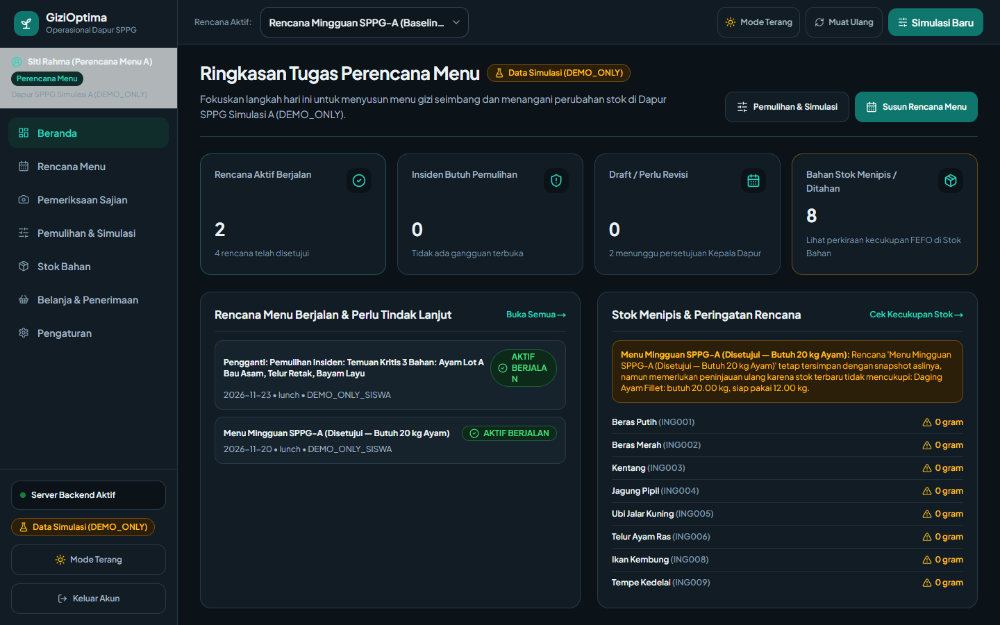
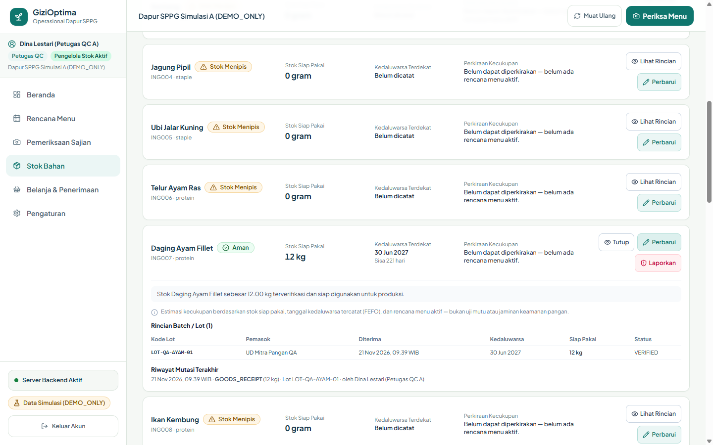
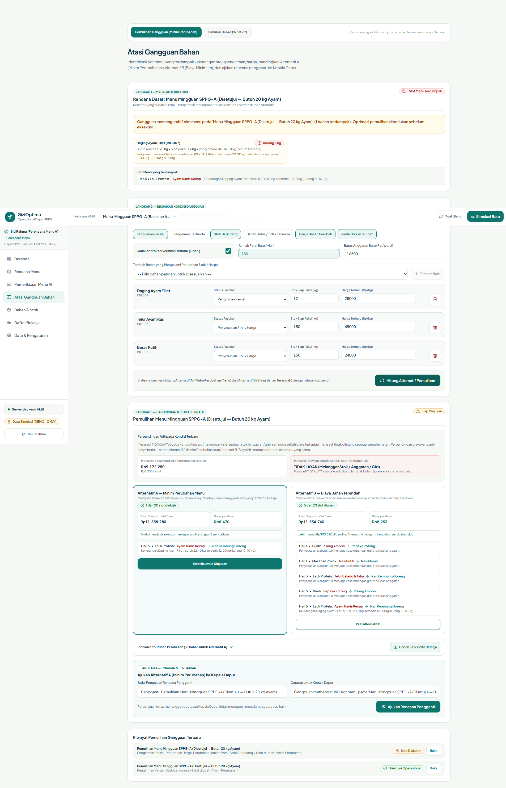
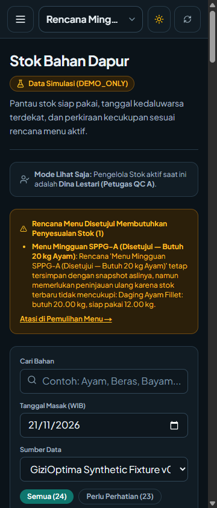
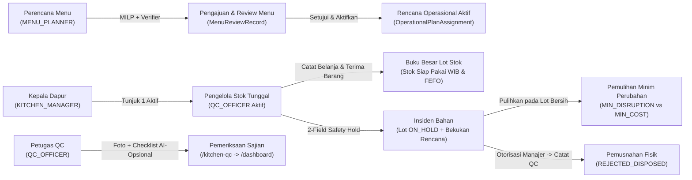

<div align="center">

# GiziOptima 

### Adaptive Kitchen Operations, Safety Hold & Procurement Recovery Engine

[](apps/web/package.json)
[](apps/web/package.json)
[](services/api/requirements.txt)
[](services/api/app/optimizer)
[](services/api/alembic/versions)
[](apps/web/src/hooks/useTheme.tsx)
[](services/api/tests)
[](apps/web/src/test)

*Sistem pendukung keputusan operasional dapur SPPG dari hulu ke hilir: optimasi menu gizi-anggaran berbasis MILP, tata kelola penulis stok tunggal (`1 Pengelola Stok` per dapur), dokumentasi bukti belanja nyata, isolasi bahan bermasalah (`Safety Hold`), pemulihan gangguan minim perubahan, hingga `Pemeriksaan Sajian` berbantuan AI opsional.*

</div>

> [!IMPORTANT]
> **Batasan Penggunaan (`DEMO_ONLY` / Simulasi Teknis):** Seluruh dataset bawaan dan fixture uji bersifat **sintetis untuk demonstrasi teknis**. Aplikasi ini merupakan sistem pendukung keputusan operasional internal dapur SPPG dan **bukan** pengganti validasi ahli gizi klinis, uji laboratorium/BPOM, sertifikasi SLHS/halal, ataupun pelaporan resmi BGN/SIPGN.

---

## Pratinjau Antarmuka (Light & Dark Mode + Mobile-First)

| Ringkasan Perencana (`Dark Mode`) | Stok Bahan & Lot Penerimaan Nyata (`QC Pengelola Stok`) |
| :---: | :---: |
|  |  |

| Pemulihan Gangguan `MIN_DISRUPTION` vs `MIN_COST` | Tampilan Mobile `360px` (`Dark Mode`, `0 px` Overflow) |
| :---: | :---: |
|  |  |

---

## Mengapa GiziOptima?

Operasional dapur pangan bergizi menghadapi masalah nyata setiap hari: harga komoditas berfluktuasi, pengiriman pemasok datang parsial/terlambat, bahan pangan ditemukan rusak atau dicurigai tidak aman di gudang dingin, sementara menu harian harus tetap memenuhi batas gizi dan anggaran tanpa membingungkan tim di lapangan.

**Prinsip Inti Arsitektur:**
1. **Lindungi Manusia Dulu, Pulihkan Menu Kedua, Optimalkan Biaya Ketiga** — Lot bermasalah (`ON_HOLD` / `REJECTED_DISPOSED`) langsung bernilai `0 g` di mesin hitung dan tidak pernah disusupkan kembali lewat *override* internal.
2. **Satu Penulis Stok Aktif per Dapur** — Kepala Dapur mendelegasikan tepat **1 Petugas QC Pengelola Stok aktif** untuk mencatat penerimaan barang, penyesuaian stok, pelaporan penahanan, dan eksekusi pemusnahan fisik agar saldo tidak bertabrakan.
3. **Solver Deterministik + Verifikator Independen** — Penjadwalan menu memakai PuLP/CBC MILP dengan audit ulang oleh `verifier.py` dari data mentah; bila mustahil dipenuhi, sistem jujur melaporkan `INFEASIBLE`.
4. **AI sebagai Asisten Opsional, Bukan Penentu Akhir** — `Pemeriksaan Sajian` (`/kitchen-qc`) tetap dapat difoto, diisi manual, dan dikirim ke Kepala Dapur meskipun penyedia AI sedang tidak aktif.

---

## Alur Operasional Multi-Aktor



### Matriks Peran & Guardrail Akses (RBAC Backend-Enforced)

| Aktor | Tugas Utama | Batasan & Guardrail Ketat |
|---|---|---|
| **Kepala Dapur** (`KITCHEN_MANAGER`) | Delegasi 1 Pengelola Stok aktif, tinjau & aktifkan rencana menu, verifikasi kecocokan bukti belanja (`VERIFIED_MATCH`), otorisasi pemusnahan lot, tinjau foto `Pemeriksaan Sajian` | Tidak menulis mutasi stok langsung ke ledger; tidak dapat melepas *safety hold* sepihak (`403`); tidak bisa mengubah histori/bukti AI asli |
| **Perencana Menu** (`MENU_PLANNER`) | Impor paket CSV tervalidasi, jalankan optimasi MILP & *what-if*, pulihkan gangguan (`Atasi Gangguan Bahan`), ekspor CSV daftar belanja, ajukan rencana ke Manajer | Tidak dapat menyetujui rencana sendiri; *stock override* di atas lot bersih saat *safety hold* aktif ditolak (`409`) |
| **Petugas QC — Pengelola Stok Aktif** (`QC_OFFICER`) | Catat belanja & unggah struk/faktur (tanpa *auto-fill*), catat penerimaan fisik & penyesuaian stok, lapor insiden cepat **2 field**, eksekusi pemusnahan fisik, lakukan `Pemeriksaan Sajian` | Dilarang melihat seluruh nominal biaya, harga satuan `Rp`, biaya/porsi di header, dan referensi harga pasar (`market_price_references`) |
| **Petugas QC Cadangan / Lihat Saja** (`QC_OFFICER`) | Lakukan `Pemeriksaan Sajian` (`/kitchen-qc`), pantau stok bahan & kedaluwarsa (`Mode Lihat Saja` tersinkronisasi live 3–4 detik saat penugasan dialihkan) | Setiap mutasi ledger/penerimaan/penahanan ditolak backend `403 Forbidden`; seluruh data harga tetap tersembunyi |

---

## Fitur Utama yang Terimplementasi

- **Optimasi Menu Berbasis Resep (`PuLP/CBC` + Independent Verifier):** Menegakkan batas energi, protein, lemak, karbohidrat, serat, zat besi (berbasis BDD dan retensi masak), alergen, batas pengulangan keluarga resep, dan anggaran harian.
- **Tata Kelola Penulis Stok Tunggal (`0007_post3c_ops_custodian_evidence`):** Indeks unik `active_kitchen_key` menjamin paling banyak 1 Pengelola Stok aktif per dapur; dicek real-time pada tiap HTTP request dan tersinkronisasi live antar-sesi browser tanpa reload.
- **Bukti Belanja & Penerimaan Barang Terverifikasi:** Mendukung unggah foto (JPEG/PNG/WEBP dengan penghapusan metadata **EXIF**) maupun dokumen PDF (pemblokiran konten aktif `/JavaScript`, `/OpenAction`, `/Encrypt`, batas **10 MB**, `Cache-Control: private, no-store`). Barang kondisi `GOOD` bertanggal kedaluwarsa langsung menambah lot siap pakai lengkap dengan nama pemasok nyata.
- **Kualitas Stok WIB & Prakiraan Kecukupan FEFO:** Memisahkan `recorded_raw_g` vs `usable_raw_g` menurut tanggal masak `Asia/Jakarta` (WIB), kedaluwarsa, rusak, reservasi, selisih hitung, serta penahanan keamanan.
- **Pelaporan Insiden Cepat 2 Field & Pemusnahan 2 Langkah:** Pelaporan cukup **2 klik** (pilih lot + kondisi/penyebab; unggah foto terpisah agar *safety hold* tetap aman bila upload gagal). Pelepasan internal selalu ditolak **`403 Forbidden`**, sedangkan pemusnahan permanen memisahkan otorisasi Kepala Dapur dan eksekusi buku besar Pengelola Stok (`REJECTED_DISPOSED`).
- **Pemulihan Pengadaan Adaptif (`MIN_DISRUPTION` vs `MIN_COST`):** Formulasi leksikografis 2-tahap mencari jadwal pengganti dengan pergantian slot paling sedikit lalu meminimalkan biaya pada lot bersih tersisa, lengkap dengan perbandingan 4-arah bebas klaim penghematan palsu dan *stale inventory snapshot guard* (`409`).
- **`Pemeriksaan Sajian` AI-Opsional & Tema Light/Dark:** Petugas QC dapat menyelesaikan dokumentasi foto + daftar periksa manual tanpa memaksa Vision AI aktif; antarmuka responsif di `320 px`–`1440 px` dalam **Mode Terang (`#F5F8F5`)** maupun **Mode Gelap (`#0B1319`)**.

---

## Struktur Repositori

```text
.
├── apps/
│   └── web/                      # Frontend Next.js 15 App Router + React 19 + Tailwind CSS v4
│       └── src/
│           ├── app/              # Rute (/dashboard, /menu-planning, /simulator, /inventory, /shopping-list, /kitchen-qc, /settings, /login)
│           ├── components/       # UI sadar peran, CustodianDelegationCard, IncidentPanel, RecoveryWorkspace, DailyCostChart, ThemeToggle
│           ├── hooks/            # AuthProvider, WorkspaceStateProvider (4s live sync), ThemeProvider (Light/Dark + localStorage)
│           └── test/             # 8 suite pengujian Vitest (24 test)
├── services/
│   └── api/                      # Backend FastAPI + SQLAlchemy 2 + Alembic + PuLP/CBC MILP
│       ├── alembic/versions/     # Migrasi skema 0001 s.d. 0007_post3c_ops_custodian_evidence
│       ├── app/
│       │   ├── api/routes/       # REST API v1 (/auth, /stock-custodian, /procurement, /inventory, /incidents, /recovery, /operational-plans, /qc, /dashboard)
│       │   ├── auth/             # Cookie HttpOnly + CSRF, Argon2id, RBAC & cek custodian real-time
│       │   ├── custodian/        # Delegasi Pengelola Stok tunggal per dapur
│       │   ├── procurement/      # Dokumen pembelian, sanitasi bukti 10 MB & goods receipt
│       │   ├── incidents/        # Safety hold multi-lot, paparan produksi & pemusnahan 2 langkah
│       │   ├── inventory/        # Usable inventory, zona waktu WIB, FEFO coverage & manual adjustment
│       │   ├── operations/       # Siklus hidup OperationalPlanAssignment (active_scope_key UNIQUE)
│       │   ├── optimizer/        # MILP model builder, solver CBC, verifier independen & diagnostik
│       │   ├── recovery/         # Optimasi minimum-disruption & perbandingan kontrafaktual 4-arah
│       │   └── vision/           # Keamanan foto sajian & adaptor Vision AI opsional
│       ├── scripts/              # CLI administrasi dapur/user & seed akun demo
│       └── tests/                # Suite pytest (87 test)
├── datasets/                     # Artefak dataset pendukung
└── qa/                           # Bukti QA Playwright, audit 7 viewport & screenshot Light/Dark
```

---

## Menjalankan Aplikasi Secara Lokal

### 1. Prasyarat
- **Python 3.11+** & `pip`
- **Node.js 20+** & `npm`

### 2. Backend (`services/api`)

```powershell
cd services/api
python -m venv .venv
.\.venv\Scripts\python.exe -m pip install -r requirements.txt
.\.venv\Scripts\alembic.exe upgrade head
.\.venv\Scripts\python.exe scripts/seed_demo_users.py --password "DemoPassword!2026"

# Jalankan dengan provider Vision uji deterministik lokal (tanpa API key eksternal)
$env:GIZIOPTIMA_VISION_PROVIDER="deterministic_test"
.\.venv\Scripts\uvicorn.exe app.main:app --host 127.0.0.1 --port 8000
```

> OpenAPI Swagger tersedia di `http://127.0.0.1:8000/docs`.

### 3. Frontend (`apps/web`)

```powershell
cd apps/web
copy .env.example .env.local
npm install
npm run build
npm run start
```

Buka **`http://127.0.0.1:3000`** di browser (pengalih **Mode Gelap / Mode Terang** tersedia di pojok kanan atas `/login`, header aplikasi, sidebar, dan halaman `/settings`).

### Akun Demo Lokal (`DEMO_ONLY` — Kata Sandi: `DemoPassword!2026`)

| Username | Peran | Dapur | Keterangan |
|---|---|---|---|
| `kepala_dapur` | `KITCHEN_MANAGER` | Dapur Simulasi A | Tinjauan menu, delegasi stok, verifikasi struk, otorisasi pemusnahan |
| `perencana_menu` | `MENU_PLANNER` | Dapur Simulasi A | Optimasi MILP, pemulihan gangguan, impor CSV |
| `petugas_qc` | `QC_OFFICER` | Dapur Simulasi A | Pengelola Stok Aktif awal + `Pemeriksaan Sajian` |
| `petugas_qc_2` | `QC_OFFICER` | Dapur Simulasi A | Petugas QC cadangan (`Mode Lihat Saja` saat tidak ditunjuk) |
| `kepala_dapur_b`, `perencana_menu_b`, `petugas_qc_b`, `petugas_qc_b_2` | Multi-peran | Dapur Simulasi B | Isolasi lintas dapur |

---

## Verifikasi & Kualitas Terukur

| Layer | Perintah | Hasil Terukur |
|---|---|---|
| **Backend (`pytest`)** | `.\.venv\Scripts\pytest.exe -q` | **87 passed, 1 warning** (Alembic roundtrip `0007`, custodian tunggal, bukti belanja & PDF aman, pemusnahan 2 langkah, 3-ingredient safety hold, RBAC/isolasi dapur, persistensi restart) |
| **TypeScript** | `npm run typecheck` | **0 errors** (`tsc --noEmit`) |
| **Frontend (`Vitest`)** | `npm test` | **8 test files, 24 tests passed** (termasuk `theme.test.tsx`, `post3c-ops-workflow.test.tsx`, `sprint3c-incidents.test.tsx`, `sprint3b-recovery.test.tsx`) |
| **Production Build** | `npm run build` | **13/13 routes** terkompilasi bersih (`Next.js 15.5.29`) |
| **Live Browser QA (Playwright)** | Multi-sesi & 7 viewport (`320–1440 px`) | Sinkronisasi pencabutan/pengalihan stok `3.0–4.1 detik` tanpa reload, **56/56** cek layout `0 px` horizontal overflow, **Light & Dark Mode** persisten + `0` error konsol |
| **Integritas SQLite** | `PRAGMA quick_check` & `foreign_key_check` | `ok` dan `[]` lintas restart daemon `uvicorn` |
